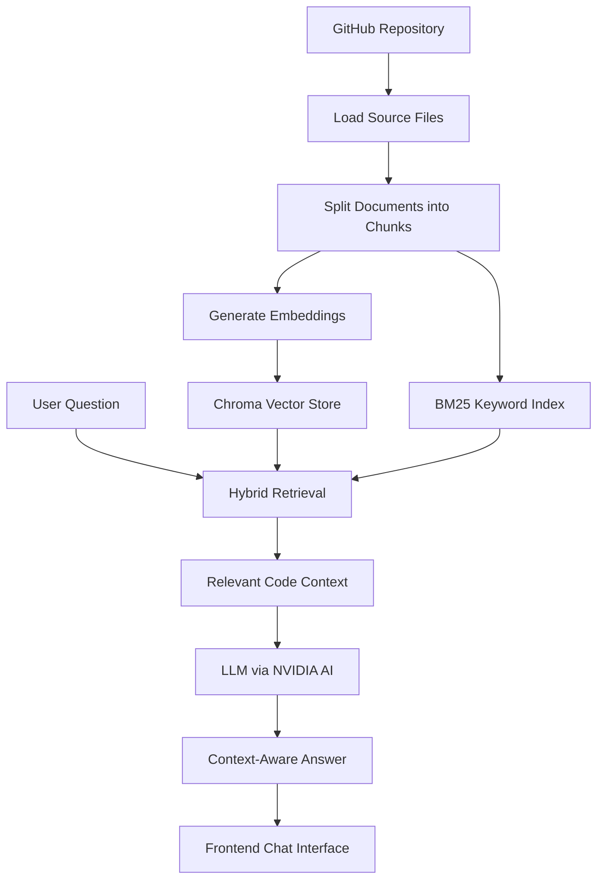

# 🧠 CodeMind — Your AI-Powered Codebase Assistant

## 🚀 Live Demo

**Try CodeMind here:** [🌐 CodeMind – Live Website](https://codemind-frontend-iota.vercel.app/)

Explore the deployed application directly in your browser!

> **Understand code. Explore repositories. Ask better questions. Build smarter.**

CodeMind is an AI-powered codebase assistant designed to help developers explore GitHub repositories and understand code through natural-language conversations. Instead of manually searching through files, you can ask questions and let retrieval-augmented generation (RAG) bring relevant code context to the conversation.

Built with **Python, LangChain, FastAPI, NVIDIA AI, and hybrid retrieval**, CodeMind brings together semantic understanding and keyword-based search to make exploring codebases more intuitive.

---

## ✨ What Makes CodeMind Special?

🔍 **GitHub Code Retrieval**  
Connect code retrieval workflows with GitHub repositories to bring relevant source code into the question-answering pipeline.

🧠 **Retrieval-Augmented Generation (RAG)**  
Retrieve relevant code context before generating answers, helping the model respond based on repository content rather than relying only on its general knowledge.

⚡ **Hybrid Search**  
Combine dense vector retrieval with BM25 keyword retrieval to find code using both semantic similarity and exact terms.

💬 **Conversational Code Understanding**  
Ask natural-language questions about a codebase and explore its implementation through an AI-powered chat experience.

🧩 **Vector-Based Knowledge Storage**  
Use Chroma to store and retrieve embedded code and documentation chunks.

🔌 **API-Driven Architecture**  
Separate the backend from the frontend to support a more flexible, maintainable application.

🛠️ **Developer-Focused Design**  
Built to make understanding unfamiliar repositories easier, whether you're learning a project, exploring implementation details, or navigating a larger codebase.

---

## 🏗️ How It Works

CodeMind follows a retrieval-first workflow to answer questions using relevant repository context.



### The workflow

1. **Load** — Retrieve relevant source files from a GitHub repository.
2. **Process** — Split the loaded content into manageable document chunks.
3. **Index** — Generate embeddings and store the resulting representations in Chroma.
4. **Search** — Retrieve relevant context using vector similarity and BM25 keyword search.
5. **Generate** — Pass the retrieved context and user question to the language model.
6. **Respond** — Return the generated answer through the application interface.

---

## 🧰 Tech Stack

| Technology | Purpose |
|---|---|
| Python | Core application logic |
| LangChain | LLM orchestration and retrieval pipelines |
| FastAPI | Backend API |
| NVIDIA AI / NVIDIA NIM | Language models and embedding integration |
| ChromaDB | Vector storage and semantic retrieval |
| BM25 | Keyword-based document retrieval |
| GitHub integration | Repository source-code retrieval |
| Frontend | User-facing application interface |

---

## 🚀 Getting Started

### Prerequisites

Make sure you have the following installed:

- Python 3.10 or a compatible version for your dependencies
- Git
- Access to the NVIDIA model or embedding services used by your configuration
- Node.js, if your frontend requires it

### 1. Clone the repository

```bash
git clone https://github.com/SinhaPushkar047/CodeMind.git
cd CodeMind
```

### 2. Create a virtual environment

**Windows (PowerShell)**

```powershell
python -m venv myenv
.\myenv\Scripts\Activate.ps1
```

**macOS / Linux**

```bash
python3 -m venv myenv
source myenv/bin/activate
```

### 3. Install dependencies

```bash
python -m pip install --upgrade pip
pip install -r requirements.txt
```

### 4. Configure environment variables

Create a `.env` file in the location expected by the backend configuration. Add the API credentials required by your selected NVIDIA models.

For example:

```env
NVIDIA_API_KEY=your_nvidia_api_key
```

Replace the placeholder with your own credential. Keep `.env` out of version control, and never publish API keys in your source code or README.

### 5. Start the backend

Run the FastAPI application using the actual Python module and application variable defined in your backend.

For example, if the entry point is `api.py` and the FastAPI instance is named `app`:

```bash
uvicorn api:app --reload
```

The development server will normally be available at:

```text
http://127.0.0.1:8000
```

FastAPI's interactive API documentation is normally available at:

```text
http://127.0.0.1:8000/docs
```

### 6. Start the frontend

Open a separate terminal, navigate to the `frontend/` directory, install its dependencies using the package manager specified by the project, and run its configured development command.

> **Note:** The frontend commands, environment-variable names, model configuration, and backend entry point should be checked against the current source files before treating these instructions as an exact installation guide.

---

## 💡 Example Use Cases

Questions you could ask a codebase assistant include:

- "What is the overall architecture of this repository?"
- "Explain how the backend handles user requests."
- "Which files are responsible for retrieving relevant code?"
- "Explain the purpose of this function in simple terms."
- "How does the application generate embeddings and retrieve documents?"
- "Where should I look if I want to modify the retrieval pipeline?"

The accuracy of each answer depends on the repository content that is loaded, the context retrieved, and the language model used.

---

## 🗺️ Roadmap

The following are potential directions for future development, not claims about features already implemented.

- [ ] Improve repository ingestion and code-aware chunking.
- [ ] Add file and symbol references to generated answers.
- [ ] Improve hybrid retrieval and result ranking.
- [ ] Support larger repositories and more programming languages.
- [ ] Add conversation management and configurable chat sessions.
- [ ] Stream responses for a more responsive chat experience.
- [ ] Add repository indexing status and retrieval diagnostics.
- [ ] Containerize the application with Docker.
- [ ] Add automated tests and CI/CD workflows.
- [ ] Improve deployment documentation and production configuration.

---

## 🎯 Project Goals

CodeMind explores how modern AI application components can work together to make software repositories easier to understand.

The project focuses on:

- Applying RAG to software engineering workflows.
- Combining semantic search with traditional information retrieval.
- Connecting language models to real source-code context.
- Building a modular backend and frontend architecture.
- Making AI-assisted code exploration more practical for developers.

---

## 🤝 Contributing

Contributions, suggestions, and bug reports are welcome!

1. Fork the repository.
2. Create a feature branch.
3. Make your changes and test them.
4. Commit your changes with a descriptive message.
5. Open a pull request.

For substantial changes, consider opening an issue first to discuss the proposed improvement.

---

## 🔐 Security

- Never commit API keys, tokens, or private credentials.
- Use environment variables for secrets.
- Review repository permissions before indexing private source code.
- Avoid logging sensitive source code or credentials unnecessarily.

---

## 👨‍💻 Author

**Pushkar Sinha**

B.Tech student at NIT Jamshedpur | Electronics and Communication Engineering | AI/ML Enthusiast

- GitHub: [@SinhaPushkar047](https://github.com/SinhaPushkar047)

---

## ⭐ Support the Project

If CodeMind interests you, consider giving the repository a ⭐ on GitHub.

Explore the code, share feedback, and help make AI-powered code understanding better.

**CodeMind — Less time searching. More time understanding.** 🚀
